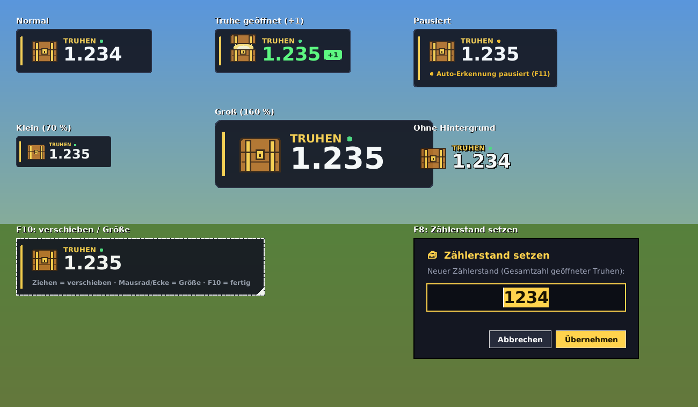

# 🧰 Fortnite Chest Counter

Zählt, wie viele Truhen du in Fortnite insgesamt geöffnet hast. Der Zähler aktualisiert sich live und wird als Overlay direkt über dem Spiel angezeigt.

- **Automatische Erkennung** per Bilderkennung: Das Tool erkennt den Truhen-Hinweis und deinen Tastendruck.
- **Hotkeys** zum Korrigieren: `F6` = +1, `F7` = −1
- **Startwert** setzen: beim ersten Start, jederzeit mit `F8` oder per `--set`
- **Gesamtzahl** wird dauerhaft gespeichert und bleibt auch nach Neustarts erhalten.
- **Ingame-Overlay** im eigenen Design: immer im Vordergrund und klick-durchlässig. **Größe und Position sind frei einstellbar.**



> **Ist das erlaubt?** Das Tool liest **keinen** Spielspeicher, verändert keine Spieldateien und injiziert nichts. Es macht nur Screenshots eines kleinen Bildschirmausschnitts und zeichnet ein eigenes Fenster darüber, genau wie OBS oder das Discord-Overlay.

> **Warum Bilderkennung?** Epic stellt die Zahl der geöffneten Truhen nirgends bereit, weder per API noch in Statistiken oder Logdateien. Das Tool muss das Öffnen deshalb selbst erkennen.

---

## Installation (Windows)

1. Installiere **Python 3.10 oder neuer** von <https://www.python.org/downloads/>. Setze beim Setup den Haken bei **„Add python.exe to PATH“**.
2. Lade dieses Repository herunter (grüner Button „Code“ → „Download ZIP“) und entpacke es.
3. Starte **`start.bat`** per Doppelklick. Beim ersten Mal werden automatisch alle Abhängigkeiten installiert.
4. Beim allerersten Start fragt das Tool nach deinem **Startwert**, also wie viele Truhen du schon geöffnet hattest, bevor du mit dem Zählen anfängst.

Optional baut **`build_exe.bat`** eine einzelne `dist\FortniteChestCounter.exe`, die ohne Python-Installation läuft.

### Fortnite-Einstellung (wichtig für das Overlay)
Stell in Fortnite unter **Einstellungen → Grafik → Fenstermodus** die Option **„Rahmenloses Fenster“** (bzw. „Fullscreen Windowed“) ein. Im exklusiven Vollbild verdeckt das Spiel jedes andere Fenster, und das Overlay ist nicht zu sehen.

---

## Einrichtung der automatischen Erkennung (einmalig)

1. Geh in Fortnite zu einer Truhe, zum Beispiel im Kreativmodus oder im Match, und schau sie an, sodass der Hinweis **„Truhe / Durchsuchen“** erscheint.
2. Drück **`F9`**. Das Tool speichert den Hinweis als Vorlage, und im Overlay erscheint „Vorlage gespeichert“.
3. Fertig. Ab jetzt zählt das Tool automatisch **+1**, sobald du die Truhe mit deiner Interaktionstaste öffnest.

Tipps:
- Am besten kalibrierst du vor einem eher dunklen Hintergrund. Das Tool schneidet automatisch auf den hellen Text zu.
- Du kannst mehrmals `F9` drücken, zum Beispiel für verschiedene Truhenarten. Alle Vorlagen werden verwendet.
- Läuft die Erkennung schlecht, lösch den Ordner `templates` im Datenordner (siehe unten) und kalibriere neu.

### So zählt die Erkennung
Das Tool scannt etwa 15-mal pro Sekunde den Bereich rechts vom Fadenkreuz. Es zählt nur, wenn alle drei Bedingungen erfüllt sind:
1. Der Truhen-Hinweis ist sichtbar.
2. Du drückst deine Interaktionstaste (Standard `E`).
3. Der Hinweis verschwindet kurz danach, weil die Truhe offen ist.

Läufst du an einer Truhe nur vorbei oder drückst E ohne Hinweis, zählt nichts. Ein Cooldown von 1,5 s verhindert Doppelzählungen.

---

## Hotkeys

| Taste | Funktion |
|---|---|
| `F6` | **+1 Truhe** |
| `F7` | **−1 Truhe** (Korrektur) |
| `F8` | Zählerstand / Startwert manuell setzen |
| `F9` | Truhen-Hinweis als Vorlage kalibrieren |
| `F10` | Verschiebe-Modus an/aus: Overlay mit der Maus ziehen, **Größe per Mausrad** oder am Griff unten rechts |
| `F11` | Auto-Erkennung pausieren/fortsetzen |
| `Strg+Bild↑` / `Strg+Bild↓` | Overlay **größer / kleiner** (auch mitten im Spiel) |
| `Strg+Shift+F12` | Programm beenden |

Die Hotkeys funktionieren global, also auch, während Fortnite im Fokus ist.

### Startwert / Zählerstand setzen
- **Beim ersten Start** erscheint automatisch ein Eingabefenster.
- **Jederzeit** öffnet `F8` das Eingabefenster. Zahl eintippen und mit Enter bestätigen. Wechsle bei Bedarf kurz mit Alt+Tab aus dem Spiel.
- **Per Kommandozeile:** `start.bat --set 250`, alternativ `python run.py --set 250`.
- Den aktuellen Stand zeigt `python run.py --show` an.

---

## Aussehen & Größe

- **Größe ändern:** Mit `Strg+Bild↑` / `Strg+Bild↓` geht es in 10-%-Schritten von 50 % bis 300 %. Alternativ drückst du `F10` und drehst das Mausrad über dem Overlay oder ziehst am weißen Dreieck unten rechts.
- **Verschieben:** Drück `F10`, zieh das Overlay an die gewünschte Stelle und drück erneut `F10`.
- Größe und Position werden gespeichert und bleiben nach einem Neustart erhalten.
- Bei jeder geöffneten Truhe geht der Deckel des Symbols auf, die Zahl leuchtet grün, und kurz erscheint **+1**.
- Der Punkt neben „TRUHEN“ zeigt den Status: 🟢 Erkennung aktiv · 🟡 pausiert · 🔴 Problem, zum Beispiel noch keine Vorlage. Bei 🟡 und 🔴 steht der Grund darunter.

Weitere Optionen in `config.json` unter `overlay`:

| Option | Standard | Bedeutung |
|---|---|---|
| `scale` | `1.0` | Größe (0.5 – 3.0) |
| `opacity` | `0.92` | Deckkraft des ganzen Overlays (0.3 – 1.0) |
| `background` | `true` | `false` = nur Truhe und Zahl mit Schatten, ohne dunkles Panel |
| `label` | `"Truhen"` | Beschriftung über der Zahl |
| `color` | `"#FFD34D"` | Akzentfarbe (Gold) |
| `number_color`, `flash_color` | Weiß, Grün | Farbe der Zahl normal und beim +1 |
| `panel_color`, `border_color` | Dunkelblau-grau | Hintergrund und Rand des Panels |

---

## Konfiguration

Alle Einstellungen stehen in `config.json` im **Datenordner**:

```
%APPDATA%\FortniteChestCounter\
  config.json   – Einstellungen
  stats.json    – dein Zählerstand
  templates\    – Vorlagen aus der Kalibrierung
  log.txt       – Protokoll (bei Problemen hier nachschauen)
```

Wichtige Optionen:

| Option | Standard | Bedeutung |
|---|---|---|
| `hotkeys.*` | siehe oben | Tastennamen (z. B. `"f8"`, `"ctrl+k"`) oder Scan-Codes als Zahl |
| `interact_key` | `"e"` | Deine Interaktionstaste in Fortnite |
| `detection.region` | `[0.48, 0.45, 0.78, 0.70]` | Scan-Bereich als Anteil des Bildschirms (links, oben, rechts, unten) |
| `detection.match_threshold` | `0.75` | Wie genau die Vorlage passen muss: höher = strenger, niedriger = toleranter |
| `detection.brightness_threshold` | `200` | Ab welcher Helligkeit ein Pixel als Text zählt |
| `detection.monitor` | `1` | Bildschirm, auf dem Fortnite läuft |
| `overlay.*` | | Aussehen & Größe (siehe oben) |

Nach Änderungen das Programm neu starten.

---

## Probleme?

| Problem | Lösung |
|---|---|
| Overlay ist im Spiel nicht sichtbar | Fortnite auf **„Rahmenloses Fenster“** stellen |
| Hotkeys reagieren nicht | `start.bat` per Rechtsklick **als Administrator** starten |
| F6/F7 sind schon anders belegt | In `config.json` unter `hotkeys` andere Tasten eintragen, z. B. `"increment": "f2"` |
| Truhen werden nicht gezählt | Neu kalibrieren (`F9`), `match_threshold` z. B. auf `0.65` senken, `interact_key` prüfen |
| Es wird zu viel gezählt | `match_threshold` z. B. auf `0.85` erhöhen. Mit `F7` korrigieren |
| Andere Auflösung / mehrere Monitore | `detection.monitor` und `detection.region` anpassen, dann neu kalibrieren |

Wer die Interaktion auf die Maus (z. B. das Mausrad) gelegt hat, zählt mit `F6`/`F7`. Die Erkennung wertet nur Tastaturtasten aus.

---

## Entwicklung

```bash
pip install -r requirements-dev.txt
python -m pytest
```

Struktur:

```
chest_counter/
  app.py       – verdrahtet Erkennung, Hotkeys, Speicherung, Overlay
  detector.py  – Bildverarbeitung + Zustandsautomat (ohne Bildschirm testbar)
  capture.py   – Bildschirmaufnahme (mss)
  hotkeys.py   – globale Hotkeys (keyboard)
  overlay.py   – transparentes tkinter-Overlay
  storage.py   – Zählerstand (atomar gespeichert)
  config.py    – Standardwerte + config.json
tests/         – Tests mit synthetischen Bildern
```
